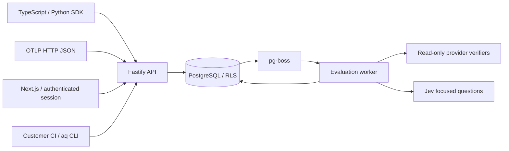

# Architecture

Agent Quality evaluates completed customer runs asynchronously. Customer agents and regression runners execute in customer infrastructure.

`apps/web` owns presentation. `apps/api` owns authentication, authorization and application use cases. `apps/worker` owns job execution. `packages/contracts` owns runtime-validated public contracts. `packages/db` owns transaction-local tenant context and migrations. Database migration credentials are separate from the application connection.

Every tenant transaction uses `set_config(..., true)`, so tenant context ends at commit or rollback. The runtime role is neither superuser nor BYPASSRLS. Composite foreign keys keep references inside a workspace and project. Partitions have no direct application grants. Narrow security-definer functions perform credential lookup and initial workspace creation; clients cannot select other tenants' keys. API roles are reloaded from membership on each request.

Authentication modes are explicit: local, seeded password authentication for development; Supabase Auth with issuer/audience and JWKS verification for production. Production refuses local sessions. Supabase Auth owns email verification and production password policy. The platform does not log trace bodies or credentials.

Quality, execution, processing and verification are independent. Provider observations establish state at an observation time; customer receipts keep their own provenance. Reported tool output cannot establish external verification. Frozen assessments remain reproducible and new evidence creates a new revision.

External services are opt-in through server environment configuration. Missing credentials produce a disconnected or unknown state. No fallback fabricates provider observations or semantic answers.
